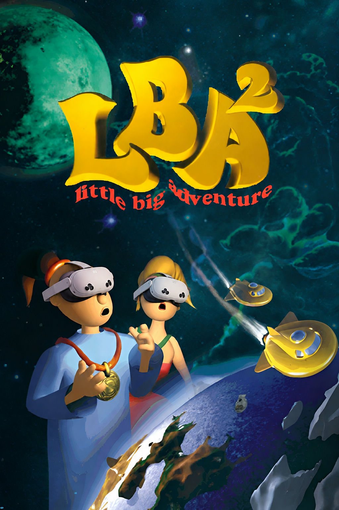
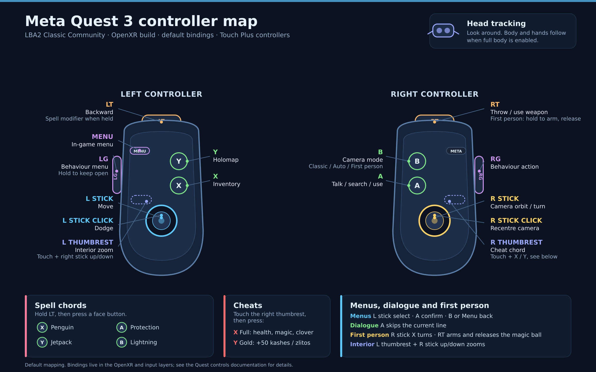

# Little Big Adventure 2 — Meta Quest port

<p align="center">
  
</p>

This repository is a fork of [LBALab/lba2-classic-community](https://github.com/LBALab/lba2-classic-community). It is a native Meta Quest port of Twinsen's Odyssey (Little Big Adventure 2), developed entirely with AI coding agents. It is not an official LBALab release, and its changes should be treated as experimental.

On Quest the game runs with native stereo 3D, full 6DoF head and controller tracking, a first-person IK body and camera, and an interior 3D parallax diorama effect. The port adds graphical improvements while keeping the original gameplay and assets intact.

The project targets mainly Quest. The same source also builds Linux, macOS, Windows and Android artifacts.

## Quest features

| Area | What it adds |
|---|---|
| OpenXR | Immersive session, native stereo 3D, full 6DoF tracking and single-pass stereo |
| First person | First-person IK body and camera, full-body hand IK and world-scale control |
| VR presentation | VR zoom, supersampling, interior hover, sub-pixel pan, passthrough, a 3D parallax diorama and a 70% movie screen |
| Graphics | OpenGL/GLES renderer from [PR #457](https://github.com/LBALab/lba2-classic-community/pull/457), texture filters, MSAA/FXAA, SSAA, soft shadows, dithering, colour grade and xBR movie upscaling |
| Controls | A confirm/use, B camera/back, X inventory, Y holomap, menu, spell chords and right-thumbrest cheats |
| Performance | 72 fps target, mostly stable through a playthrough |

<p align="center">
  
</p>

<p align="center"><em>Default Quest 3 controller map. See <a href="docs/QUEST_CONTROLS.md">Quest controls</a> for the full table.</em></p>

## Install on Quest

Requirements: a Quest 2/3/Pro with Developer Mode and USB debugging enabled, a data-capable USB cable, and your own LBA2 game data.

| Desktop | Installer download |
|---|---|
| Linux | [install-quest-linux.sh](https://github.com/simsas-experiments/lba2-classic-quest/raw/main/scripts/quest/install-quest-linux.sh) |
| macOS | [install-quest-macos.sh](https://github.com/simsas-experiments/lba2-classic-quest/raw/main/scripts/quest/install-quest-macos.sh) |
| Windows | [install-quest-windows.ps1](https://github.com/simsas-experiments/lba2-classic-quest/raw/main/scripts/quest/install-quest-windows.ps1) ([.cmd launcher](https://github.com/simsas-experiments/lba2-classic-quest/raw/main/scripts/quest/install-quest-windows.cmd)) |

Linux:

```bash
curl -fLO https://github.com/simsas-experiments/lba2-classic-quest/raw/main/scripts/quest/install-quest-linux.sh
bash install-quest-linux.sh
```

macOS:

```bash
curl -fLO https://github.com/simsas-experiments/lba2-classic-quest/raw/main/scripts/quest/install-quest-macos.sh
bash install-quest-macos.sh
```

Windows (PowerShell):

```powershell
Invoke-WebRequest -OutFile install-quest-windows.ps1 https://github.com/simsas-experiments/lba2-classic-quest/raw/main/scripts/quest/install-quest-windows.ps1
powershell -NoProfile -ExecutionPolicy Bypass -File .\install-quest-windows.ps1
```

The installer downloads temporary Android platform-tools, fetches the latest Quest APK from the [Releases page](https://github.com/simsas-experiments/lba2-classic-quest/releases), asks for the folder containing `lba2.hqr`, copies the game data to `/sdcard/lba2cc/`, and installs the APK. It does not need Docker or root. The same scripts live in [`scripts/quest/`](scripts/quest) if you already cloned the repository; on Windows, put the `.cmd` launcher beside the `.ps1` to double-click it.

On Windows, the installer reuses an existing `adb` from `PATH` or the Android SDK when it finds one; otherwise it downloads a temporary copy and Windows may ask for permission. Use `-AdbPath` to point at your own `adb.exe`.

If adb cannot see the headset, enable Developer Mode and USB debugging, use a data cable, and accept the debugging prompt in the headset. On Windows, install the Meta Quest ADB driver if the device is not listed.

Manual fallback:

```bash
adb install -r lba2cc-<version>-quest-arm64-v8a.apk
adb shell mkdir -p /sdcard/lba2cc
adb push /path/to/lba2 /sdcard/lba2cc/
```

If an older build used a different debug key, rerun the installer with `--clean` (Windows: `-Clean`). App-local saves may be lost; game data in `/sdcard/lba2cc/` is kept.

## Game data

You need a legitimate copy of LBA2 ([GOG](https://www.gog.com/game/little_big_adventure_2), [Steam](https://store.steampowered.com/app/398000/Little_Big_Adventure_2/), or your retail CD). The engine does not ship assets.

Point the game at the folder containing `lba2.hqr` (alongside `music/`, `video/`, `vox/`, …, or under a `Common/` / `CommonClassic/` subfolder). The first launch opens a folder picker; the Quest installer copies the folder for you.

## Other platforms

The same source also produces:

| Platform | Artifact |
|---|---|
| Linux | `lba2cc-<version>-anylinux-<arch>.AppImage` and `lba2cc-<version>-linux-<arch>.tar.gz` |
| macOS | `lba2cc-<version>-macos-arm64.dmg` |
| Windows | `lba2cc-<version>-windows-x64.zip` |
| Android | `lba2cc-<version>-android-<abi>.apk` |

All are published on the [Releases page](https://github.com/simsas-experiments/lba2-classic-quest/releases).

## Building from source

See [CONTRIBUTING.md](CONTRIBUTING.md) for the build prerequisites. The relevant CMake presets are `quest`, `linux`, `macos_arm64` and `windows_ucrt64`; [docs/ANDROID.md](docs/ANDROID.md) covers the Quest/OpenXR setup.

## About this fork

This is a fork of the community fork of the original [`lba2-classic`](https://github.com/2point21/lba2-classic) source release. The upstream community fork ported the assembly to C++ and added SDL3, libsmacker, native desktop/Android builds, widescreen support, gamepad play and the debug console. This fork keeps that preservation work and adds the Quest/OpenXR port.

## License

This source code is licensed under the [GNU General Public License](https://github.com/LBALab/lba2-classic-community/blob/main/LICENSE).

The license applies only to the Little Big Adventure 2 engine source. Game assets (art, models, textures, audio, etc.) are not open-source and are not redistributable.

## Links

- **Official website:** https://twinsenslittlebigadventure.com/
- **Discord:** https://discord.gg/jsTPWYXHsh
- **Docs:** https://lba-classic-doc.readthedocs.io/

## Buy the game

- [GOG](https://www.gog.com/game/little_big_adventure_2)
- [Steam](https://store.steampowered.com/app/398000/Little_Big_Adventure_2/)

## Original development team

<details>
<summary>Adeline Software International</summary>

- **Direction:** Frédérick Raynal
- **Programmers:** Sébastien Viannay / Laurent Salmeron / Cédric Bermond / Frantz Cournil / Marc Bureau du Colombier
- **3D artists and animations:** Paul-Henri Michaud / Arnaud Lhomme
- **Artists:** Yaeël Barroz, Sabine Morlat, Didier Quentin
- **Story and design:** Frédérick Raynal / Didier Chanfray / Yaël Barroz / Laurent Salmeron / Marc Albinet
- **Dialogs:** Marc Albinet
- **Story coding:** Frantz Cournil / Lionel Chaze / Pascal Dubois
- **Video sequences:** Frédéric Taquet / Benoît Boucher / Ludovic Rubin / Merlin Pardot
- **Music and sound FX:** Philippe Vachey
- **Testing:** Bruno Marion / Thomas Ferraz / Alexis Madinier / Christopher Horwood / Bertrand Fillardet
- **Quality control:** Emmanuel Oualid

Use the `credits` command in the [console](docs/CONSOLE.md) to see the full original credits.

</details>

## Copyright

The intellectual property is currently owned by [2.21]. Copyright [2.21]. Originally developed by Adeline Software International in 1994.
