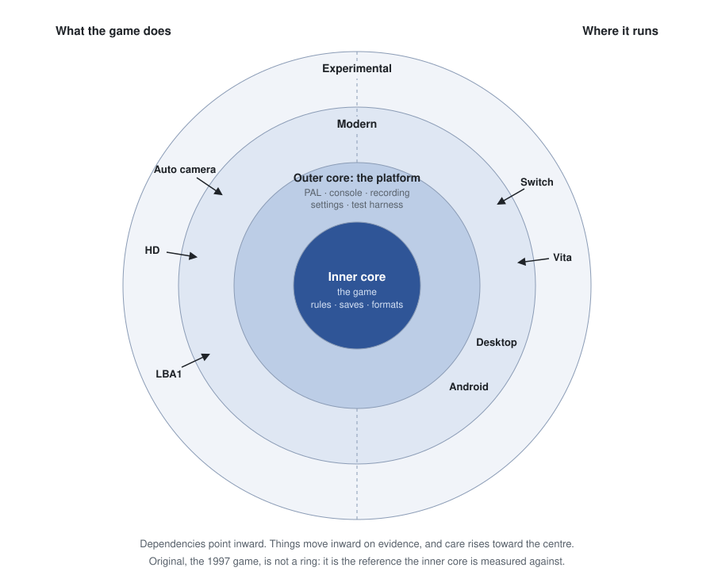

# Engine architecture — overview and roadmap

> **Status: living index (v0).** Entry point for the architecture-understanding effort.
> This is groundwork: *understanding first, no engine changes yet.* Truth hierarchy:
> code > this document > external sources.

## North-star: one engine, two games

The LBA1 community source (`lba1-classic`, Relentless, 1994) and this repo (LBA2, 1997 +
community port) share the Adeline lineage — same `LIB386/`+`SOURCES/` layout, same HQR
format, same Life/Track script model. The long-term prospect is to understand the engine
well enough that **LBA1 content could run on the lba2cc engine**. That port is not the
immediate work; the immediate work is the *understanding* that would make it tractable —
and which pays off now by telling us where to draw module boundaries (engine/game
separation, strangler-fig). Architecture is the lever; comprehension is the fulcrum. The
concrete cost of that port is assessed in [LBA1_PORTING_SURFACE.md](LBA1_PORTING_SURFACE.md).

## The three axes

The engine is mapped along three orthogonal axes. Read them together — the payoff is the
convergence.

| Axis | Doc | Question it answers |
|---|---|---|
| **Structure** | [ARCHITECTURE_GLOBALS.md](ARCHITECTURE_GLOBALS.md) | Which domain owns which of the ~200 globals? Where is the shared-state bus? |
| **Layer** | [ENGINE_GAME_SEAM.md](ENGINE_GAME_SEAM.md) | What is engine vs game vs platform? (validated against the LBA1 source) |
| **Time** | [LIFECYCLES.md](LIFECYCLES.md) | When is state created, mutated, destroyed? (main loop, `ChangeCube`) |

Underneath all three sits the **data contract** the engine reads:
[ENGINE_FILE_FORMATS.md](ENGINE_FILE_FORMATS.md) specs the on-disk formats (HQR, LZ, 3D body,
animation, sprite, samples, XMIDI, the XCF cinematic codec) at engine altitude, each with its
cross-title (LBA1/TC/LBA2) version timeline.

**The convergence is the signal.** The same small set of things surfaces on all three axes:
`ListObjet`, `CubeMode`, `Comportement`, `ChangeCube`, and the Life/Track script VM. They
are simultaneously the shared-bus offenders (structure), the engine/game membrane and
mode switches (layer), and the lifecycle pivots (time). Where the axes agree is where the
architecture actually lives — and where the first boundaries should be drawn.

## The eight domains and their deeper docs

Each domain in the structural map has a layer tag and, often, an existing subsystem doc
that goes deeper. This table is the map-of-maps.

| Domain | Layer | Deeper references |
|---|---|---|
| Gameplay / simulation | Game on engine substrate | [IMPACT_SCRIPTS.md](IMPACT_SCRIPTS.md), [LBA_EDITOR.md](LBA_EDITOR.md), [GLOSSARY.md](GLOSSARY.md) |
| Rendering | Engine | [CAMERA_INTERNALS.md](CAMERA_INTERNALS.md), [SPRITES.md](SPRITES.md), [GFX_OPTIONS.md](GFX_OPTIONS.md), [POLYREC.md](POLYREC.md) |
| World / cube transform | Engine | [SCENES.md](SCENES.md) |
| Resources / assets | Engine | [GAME_DATA.md](GAME_DATA.md), [ABI.md](ABI.md) |
| Audio | Engine + game scheduling | [AUDIO.md](AUDIO.md) |
| Platform / IO | Platform | [PLATFORM_ABSTRACTION.md](PLATFORM_ABSTRACTION.md), [PLATFORM.md](PLATFORM.md), [TIMING.md](TIMING.md), [CONFIG.md](CONFIG.md), [CONTROL.md](CONTROL.md) |
| UI / text | Engine machinery + game content | [MENU.md](MENU.md), [GLOSSARY.md](GLOSSARY.md) |
| Orchestration / lifecycle | Engine framework | [LIFECYCLES.md](LIFECYCLES.md), [SAVEGAME.md](SAVEGAME.md), [TIMING.md](TIMING.md) |

## The engine/game membrane: the script VM

The single most important seam. The engine runs a fixed main loop; the *game* is Life
scripts (behaviour AI, dispatched at main-loop step 6, `DoLife`) and Track scripts
(pathing, step 3, `DoTrack`), plus assets. `GERELIFE`/`GERETRAK`/`FUNC` implement the VM
and are present in all three Adeline trees. LBA1 uses the same VM (confirmed), so this
interface is what lets its content run here. Detailed API spec:
**[ENGINE_GAME_INTERFACE.md](ENGINE_GAME_INTERFACE.md)**.

## Gaps — what's mapped, what's left

1. **The engine↔game interface spec** — *mapped:* [ENGINE_GAME_INTERFACE.md](ENGINE_GAME_INTERFACE.md).
   The Life/Track bytecode VM: opcode tables, the `switch`-on-cursor dispatch (*not* the
   `EXTFUNC`/`PTRFUNC` tables — those turned out to be engine-internal / editor tooling),
   the syscall surface, and script-variable storage. The keystone for LBA1 portability.
2. **The LBA1 ↔ LBA2 porting surface** — *mapped:* [LBA1_PORTING_SURFACE.md](LBA1_PORTING_SURFACE.md).
   Per-subsystem compatible/shim/different verdicts. Headline: the engine is a strict
   superset, so hosting LBA1 is format transcoders + a script opcode-remap + integrating
   GPLv2 FLA/MIDI decoders (lba-midi-play, twin-e) — not re-architecting.
3. **The call-graph / data-flow axis** — *not yet mapped.* Who mutates the shared-bus
   offenders, and from where. The fourth axis; lives only in the code and the
   codebase-memory graph (weak on exactly this — sparse function→function edges).

## Strangler-fig roadmap (understanding → action, later)

When the maps are solid enough to act on, the order the three axes agree on:

1. **Keystone: the script VM facade** — the engine/game interface. Highest leverage;
   aligns with the Life/Track tooling thread (#181).
2. **First structural target: World / cube transform** — it dominates the shared-bus
   offender list, and `ChangeCube`'s phases give the exact sequence a facade must preserve.
3. **Platform: SDK boundary implemented** — [the PAL](PLATFORM_ABSTRACTION.md) owns host resources behind a C-compatible contract, with SDL3 for desktop/Android, SDL2 for desktop, and a null backend for SDK-free offscreen presentation. AIL remains the sibling audio boundary; frontend-owned frame stepping is separate work.

Each step is a facade drawn *over* frozen code, proven behaviour-identical against the
polyrec/projrec harnesses before the next. No rewrite.

## The rings and the core

Features grow in three rings, each inside the next. **Original** is the game as a 1997 player
met it: every setting at its value from before (`SETTING_BEFORE` in
[SOURCES/SETTINGS.H](../SOURCES/SETTINGS.H)). **Modern** settings change how the game is shown
or handled, never what happens in it. **Experimental** is anything else, and comes out without
ceremony. The replay digest is how the line is checked: its world hash is what the game holds,
its view hash the camera, and the same inputs giving the same world hash is the same game.

The Auto camera's settings are held to that by two fixtures, one per ring, and the one door
between the rings is the original game's own reading of what is on screen: the lightning spell
and a life-script condition act on the actors that were drawn, so a resolution or a camera can
change them. The Decision
[a-camera-setting-is-watched-not-played.md](knowledge/decisions/a-camera-setting-is-watched-not-played.md)
has the contracts and the Quirk
[the-game-counts-what-is-on-screen.md](knowledge/quirks/the-game-counts-what-is-on-screen.md)
the measurement. Read the Decision before a change that lets a setting reach the simulation.

### The core

Under the rings sits the core: what everything else is built on and cannot route around. The
test is whether changing it could break a save, a recording, a fork or a mod. The core is not
the same as Original. Original is the 1997 game, the reference the core is measured against;
the core is what has to hold still so others can build on it.

- **Inner core, the game.** Its rules, which the world hash measures, the save format and the
  game data formats. Held to its oracle: the ASM, the retail release, the savegame corpus. It
  changes only by a Decision, and a rule changes only as a retail fix with its own switch
  ([the retail-fix Decision](knowledge/decisions/a-retail-fix-is-a-switch-under-one-row.md)).
- **Outer core, the platform.** The [PAL](PLATFORM_ABSTRACTION.md) contract, console output,
  recording and replay, the settings tables and the test harness. Each is a contract pinned
  by tests; it grows by adding and does not break. A second game on the engine would share it.

Some of the core is new, and some of the original is not core. The fixed 60 Hz step and the
retail fixes are inner core though the 1997 game had neither; Miles audio and the DOS video
modes were original and were replaced. The x86 ASM is the oracle, not part of the build.

### Moving inward

Dependencies point inward: an outer ring can come off without the inner ones noticing. The
care a change takes rises toward the centre. Experimental comes out without ceremony, Modern
needs evidence before it is on by default, and the core needs a Decision.

Things move inward on evidence. For a setting moving from Experimental to Modern, or from off
to on by default:

1. Measure what it changes, on the data players have.
2. With it off, nothing changes ([test_ring_off_is_gone.sh](../tests/automation/test_ring_off_is_gone.sh)).
3. With it on, the world hash holds ([test_ring_watch_not_play.sh](../tests/automation/test_ring_watch_not_play.sh)).
4. Anything judged by feel gets a play test, read back from its trace.

The same holds for where the game runs. A port such as Switch or Vita starts outside, as a
build, and moves inward as it meets what an inner platform is held to: it builds in CI, the
test suite runs on it, a recording replays to the same world hash and a save from another
platform loads. A second game moves the same way: LBA1
work starts in Experimental, with its own inner core on the shared outer core.

## How to use these docs

Start here, then the three axes (structure → layer → time), then the per-domain subsystem
doc when you need depth. The maps are a reasoning overlay; when they disagree with the
code, the code wins.
